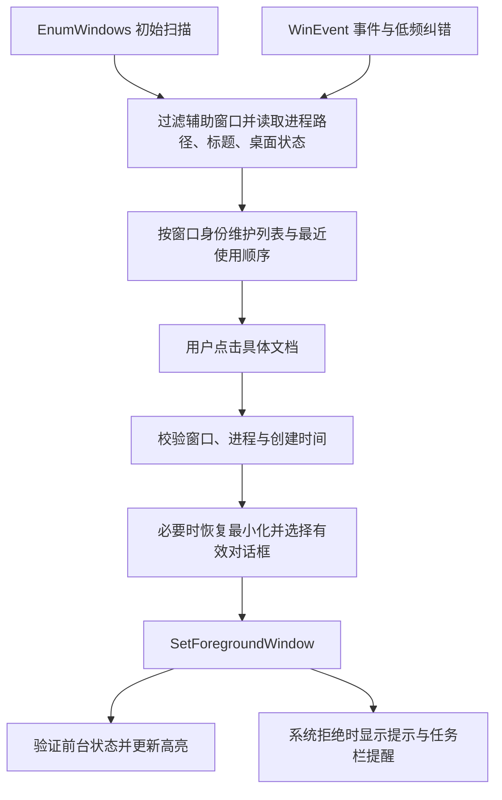

# 窗栏 WindowRail

一个简约的 Windows 纵向透明悬浮栏。把已打开的文档窗口放在手边，点击名称即可切换；同一 Word 中的多份文档分别显示，也可以保留固定程序启动入口。

[下载便携版](https://github.com/michaellee66701-oss/windowswitch/releases/latest) · [使用说明](docs/USAGE.txt) · [验证记录与回归清单](docs/TESTING.md) · [变更记录](CHANGELOG.md)

## 功能与使用

- 点击底部 **＋**，搜索并勾选当前打开的窗口，可一次添加多个。
- 每个文档窗口对应一个条目，显示图标和名称；单击切换，最小化时自动恢复。
- 当前前台窗口有淡色标记；长名称省略显示，悬停查看完整标题。
- 右键可设置别名、固定所属程序、上下移动或移除条目。
- 拖动顶部六个点移动悬浮栏，拖动条目调整顺序。
- 顶部拖动点、**···** 和 **＋** 均为透明底，文字颜色和阴影与文档名称一致。
- **···** 菜单可调宽度、背景透明度和文字明暗，也可隐藏到托盘或退出。

```text
        ⠿             ···
  W  项目方案
  W  会议纪要
  W  合同修改稿
        ＋
```

解压便携包后运行 `WindowRail/WindowRail.exe`。完整包自带私有 .NET 运行环境，不需要另行安装 .NET；请保留 EXE 旁的 DLL、配置文件和 `runtime/` 文件夹。将程序放在可写目录中，以便保存设置。

**文档窗口与固定程序是两种条目：**窗口条目绑定当前具体窗口，文档关闭后移除；固定程序入口长期保留，已有可用窗口时切回最近使用的窗口，未运行时尝试启动。固定 Word 不等于固定某个文档文件，首版不负责重新打开已关闭的指定文档。

## 项目结构

```text
WindowRail/
├─ src/WindowRail/                 WPF 应用及 Windows 互操作代码
│  ├─ App.cs                      启动、单实例、退出信号、渲染模式
│  ├─ MainWindow.xaml[.cs]         悬浮栏、交互、状态协调、托盘、多屏位置
│  ├─ WindowPicker.xaml[.cs]       窗口搜索、多选、添加
│  ├─ Models.cs                   配置模型、窗口身份、匹配规则、界面状态
│  ├─ Native.cs                   Win32 声明、窗口验证、虚拟桌面接口
│  ├─ Services.cs                 扫描、事件监听、激活、图标、配置存储
│  ├─ app.manifest                普通用户权限、Per-Monitor V2 DPI
│  └─ Assets/WindowRail.ico        应用图标
├─ tests/WindowRail.Tests/         可执行逻辑检查，共 19 项
├─ scripts/                       测试、构建、打包脚本
├─ docs/                          使用说明与验证清单
├─ .github/workflows/build.yml    Windows 自动构建与检查
└─ global.json                    .NET 10 SDK 选择策略

本地生成或私有内容，不进入 Git：
├─ .tools/dotnet/                 可选的本地 .NET SDK
├─ work/                         缓存、测试输出、临时文件
├─ dist/WindowRail/               可直接运行的完整程序
│  ├─ runtime/                   私有 .NET 运行环境
│  └─ data/                      当前用户配置和诊断日志
└─ artifacts/                    便携 ZIP 和 SHA-256 校验文件
```

## 技术路径

### 1. 技术栈与边界

| 部分 | 实现 | 选择原因 |
| --- | --- | --- |
| 语言、运行时 | C#、.NET 10，目标框架 `net10.0-windows` | 与 Windows 桌面接口直接配合 |
| 界面 | WPF / XAML | 实现透明窗口、数据绑定、图标和设置交互 |
| 窗口控制 | P/Invoke 调用 `user32.dll`，配合 DWM 与 COM 接口 | 识别和切换其他进程的真实窗口 |
| 托盘、多屏信息 | 部分 Windows Forms 类型 | 使用成熟的托盘图标和显示器信息接口 |
| 数据 | `System.Text.Json`，本地 JSON 与备份 | 配置量小，无需数据库或服务器 |
| 发布 | 应用 EXE + 私有 .NET 运行时目录 | 使用者可解压运行，不修改全局运行环境 |

应用为单进程结构，没有后台服务、驱动、进程注入、网络后端或遥测。没有额外第三方 NuGet 包依赖。Windows x64 是当前交付范围。

主窗口使用 WPF 透明无边框窗口。`WS_EX_TOOLWINDOW` 让窗栏不进入普通任务切换列表，`WS_EX_NOACTIVATE` 与鼠标激活消息处理使其平时不占用键盘焦点。只有窗栏自身保持置顶，目标程序的置顶属性保持原状。小型透明界面使用软件渲染，以兼容桌面捕获与远程显示场景。

### 2. 从窗口发现到点击切换



`WindowCatalog` 通过 `EnumWindows` 扫描顶层窗口，读取标题、进程 ID、进程创建时间及程序完整路径，过滤工具自身、辅助窗口和不适合选择的窗口。DWM 状态和 `IVirtualDesktopManager` 用于判断窗口是否可见、是否位于当前虚拟桌面。

**运行期间，窗口身份是窗口句柄 + 进程 ID + 进程创建时间。**文档名称只用于显示，不作为点击切换的唯一标识。同一个 Word 进程可以对应多份文档条目。标题或“另存为”发生变化时更新显示名；用户设置的别名优先。

激活由 `SwitchService` 完成：再次检查窗口身份；仅对最小化窗口调用 `ShowWindowAsync`；有有效弹出对话框时优先激活它；调用 `SetForegroundWindow` 后检查结果。前台激活受 Windows 规则约束，失败时提示并闪烁任务栏，不持续争抢焦点。

新选择会取消旧的异步切换。程序启动等待期间，如果用户已经进行了新的输入，则停止后续自动激活。程序正在运行但没有可用窗口时显示提示，避免将托盘程序误当成未启动而重复打开。

### 3. 事件与资源控制

- 启动时扫描一次；窗口扫描放在后台任务中。
- `SetWinEventHook` 监听前台变化、窗口创建/销毁/显示/隐藏、标题与最小化事件，跳过自身进程事件。
- 普通事件采用约 220 毫秒合并处理；每 5 秒进行一次纠错扫描。
- 图标和应用名称按程序路径缓存；仅在条目状态变化时通知界面。
- 配置保存采用约 600 毫秒延迟合并，避免拖动时频繁写文件。

### 4. 配置、恢复与单实例

配置默认在 EXE 旁的 `data/settings.json`，包括固定条目、显示别名、排列顺序、宽度、文字颜色、透明度、显示器标识与相对位置。保存时先写临时文件，再替换正式配置，并保留 `settings.json.bak`。损坏时尝试恢复备份；原损坏文件会保留供排查。

窗口句柄和进程编号不写入持久化配置。重启工具后，窗口条目仅在 **程序完整路径 + 上次完整窗口标题** 能唯一匹配时恢复。已关闭或完全同名的多个窗口不会被随意重绑定，需要用户重新添加。Word 关闭最后一份文档后有时会复用窗口显示首页，这种情况有专门规则移除原文档条目。

单实例标识由配置目录计算。同一配置目录重复启动会唤回已有窗栏；不同 `--data-dir` 可供独立开发测试。正常退出时保存配置并释放事件钩子、计时器与托盘图标。

## 开发、测试和构建

开发需要 Windows x64、Git、PowerShell，以及 **.NET 10 SDK**。只安装 .NET Runtime 不能编译项目。`global.json` 允许使用更新的 .NET 10 SDK feature band，不自动切换到下一个主版本。

在项目根目录运行：

```powershell
git clone https://github.com/michaellee66701-oss/windowswitch.git
cd windowswitch

# 执行 19 项逻辑检查，失败时返回非零退出码。
.\scripts\test.ps1

# 编译并复制私有运行环境。
.\scripts\build.ps1

# 生成不含个人配置的便携包及校验文件。
.\scripts\package.ps1

# 启动生成的应用。
.\dist\WindowRail\WindowRail.exe
```

脚本优先使用 `.tools/dotnet/dotnet.exe`，不存在时使用 PATH 中的 `dotnet`，也可显式指定：

```powershell
.\scripts\test.ps1 -Dotnet 'C:\Program Files\dotnet\dotnet.exe'
.\scripts\build.ps1 -Dotnet 'C:\Program Files\dotnet\dotnet.exe'
```

当前本地维护目录为 `E:\Project\WindowRail`，已准备 `.tools/dotnet/`；该目录仅在本机使用，不上传 GitHub。新克隆仓库的开发者需自行安装 .NET 10 SDK。

**测试项目是一个可执行检查程序，不是 xUnit/MSTest 工程。**应运行 `scripts/test.ps1`；不能把单独执行 `dotnet test` 当作这些检查已通过。

开发调试可运行：

```powershell
dotnet run --project src/WindowRail/WindowRail.csproj -- --data-dir .\work\dev-profile --test-ui
```

使用本地 SDK 时可将命令中的 `dotnet` 替换为 `.\.tools\dotnet\dotnet.exe`。`--test-ui` 仅为辅助工具暴露测试窗口，不用于日常使用。

### 发布方式说明

`scripts/build.ps1` 采用 framework-dependent 发布，再随包复制私有 .NET 10 Core、Windows Desktop 和 hostfxr 运行文件。EXE 使用 `AppHostDotNetSearch=AppRelative` 和 `AppHostRelativeDotNet=runtime`，从自身相对目录加载运行环境。因此，完整便携包在未全局安装 .NET 10 的电脑上仍可运行。这与只分发一个 framework-dependent EXE 不同。

运行时许可证及第三方声明一同复制到 `runtime/`。SDK、构建缓存、个人 `data/` 和调试日志不进入源码仓库；打包脚本也会排除发布目录中的 `data/`、日志和临时文件。

## 维护方法

### 按修改目标找到代码

| 要修改的内容 | 优先查看 |
| --- | --- |
| 透明效果、按钮、文字、行高 | `MainWindow.xaml`；`MainWindow.xaml.cs` 的 `ApplyAppearance` |
| 添加窗口面板、搜索和多选 | `WindowPicker.xaml` 与其代码文件 |
| 文档标题、同名窗口、重启恢复 | `Models.cs` 的 `WindowRules`，以及对应逻辑检查 |
| 程序/窗口发现、特殊应用兼容 | `Services.cs` 的 `WindowCatalog`，必要时修改 `Native.cs` |
| 最小化恢复、焦点、对话框 | `SwitchService` 与 `Native`；需进行真实桌面回归 |
| 配置字段、迁移与损坏恢复 | `RailConfig`、`EntryConfig`、`ConfigStore` |
| 单实例、启动参数、退出清理 | `App.cs` |
| 编译、运行时更新、ZIP 内容 | `scripts/` 与 GitHub Actions 工作流 |

### 每次修改后的流程

1. 从 `main` 拉取最新代码，创建功能分支，保持改动范围明确。
2. 修改代码和相关文档。涉及窗口匹配、标题、排序或配置恢复时，为实际风险补充检查。
3. 运行 `scripts/test.ps1`、`scripts/build.ps1`。涉及窗口行为时，按 [回归清单](docs/TESTING.md) 做桌面实测。
4. 用独立 `--data-dir` 验证，避免覆盖日常使用配置。
5. 更新 `CHANGELOG.md`，提交并推送分支，通过 PR 合并。GitHub Actions 会在 Windows 上运行逻辑检查、构建、打包并上传短期构建产物。

### 更新运行环境或发布版本

1. 将 `.NET 10 SDK` 更新到维护版本；`.tools/dotnet/` 存在时，记得同步更新，脚本会优先使用它。
2. 在 `src/WindowRail/WindowRail.csproj` 更新 `Version`，并记录变更。
3. **构建到新的目录**，避免旧运行时文件混入新包，也不要直接覆盖正在运行的程序：

   ```powershell
   .\scripts\test.ps1
   .\scripts\build.ps1 -OutputDirectory 'dist\WindowRail-next'
   .\scripts\package.ps1 -PublishDirectory 'dist\WindowRail-next'
   ```

4. 验证新包能够启动、切换文档、恢复最小化窗口、退出并恢复配置。
5. 将源码提交到 `main`，确认 Actions 成功，创建版本标签，例如 `v1.0.1`。
6. 在 GitHub Releases 发布对应标签，上传 `artifacts/WindowRail-win-x64.zip` 与 `artifacts/SHA256SUMS.txt`，说明支持范围和已验证场景。仓库源码压缩包由 GitHub 自动提供。
7. 日常用户更新时，先退出旧程序，将原 `data/` 复制到新程序目录，再启动新版。

便携包使用私有运行环境，因此系统中 .NET 的更新不会自动更新包内运行时；维护者需要重新构建并发布新包。

### 修改配置结构

当前配置版本为 `SchemaVersion = 1`。已有字段名称和枚举值属于持久化格式。新增字段应提供默认值；更改旧字段含义或删除字段前应实现迁移，并用旧版真实配置的匿名样本验证。仅提高版本号而不增加读取/迁移逻辑，会使旧配置进入恢复或重置路径。

### 常见问题排查

| 现象 | 检查方式 |
| --- | --- |
| 入口启动失败 | 确认完整解压、`runtime/` 未缺失、目录可写，查看 `data/diagnostics.log` |
| 找不到窗栏 | 双击托盘图标或再次运行同一份 EXE；检查是否从不同目录启动了不同实例 |
| 点击文档未到前台 | 确认文档未关闭、位于当前虚拟桌面、没有权限限制或阻塞对话框；按提示重试 |
| 同名文档难区分 | 给条目设置别名；重启后的歧义匹配需要重新添加 |
| 浅色桌面看不清 | 在 **···** 中切换“深色文字”，或增加条目背景透明度 |
| 固定程序仍在运行却没有窗口 | 从该程序托盘入口唤起；不要以进程存在与否代替窗口可用性 |
| 更新后配置异常 | 退出程序，先备份整个 `data/`，检查 `settings.json.bak` 及损坏配置备份 |

诊断日志位于 `data/diagnostics.log`，超过约 512 KB 后轮换。分享问题时应先检查配置中的文档标题、应用路径和别名，使用匿名复现信息。

## 当前限制与验证范围

- 支持普通 Windows x64 桌面窗口；部分管理员权限程序、商店应用、特殊宿主和启动器需要单独适配。
- 第一版不自动跨虚拟桌面切换，不承诺覆盖独占全屏、锁屏或 UAC 安全桌面。
- 切换对象是操作系统窗口，不是浏览器内部标签页或软件内部所有分页。
- 未实现指定文档文件的永久快捷启动、开机启动、自动更新和跨平台支持。
- 已通过 19 项逻辑检查，并在本机实际 Word 中验证多文档添加、名称显示、切换和最小化恢复。多显示器/DPI 硬件组合、全部权限场景和正式性能基准尚未完成全矩阵验证，详见 [验证记录](docs/TESTING.md)。

## 参考资料

- [WPF 概览](https://learn.microsoft.com/en-us/dotnet/desktop/wpf/overview/)
- [EnumWindows](https://learn.microsoft.com/en-us/windows/win32/api/winuser/nf-winuser-enumwindows)、[SetWinEventHook](https://learn.microsoft.com/en-us/windows/win32/api/winuser/nf-winuser-setwineventhook)
- [SetForegroundWindow 及系统限制](https://learn.microsoft.com/en-us/windows/win32/api/winuser/nf-winuser-setforegroundwindow)、[ShowWindowAsync](https://learn.microsoft.com/en-us/windows/win32/api/winuser/nf-winuser-showwindowasync)
- [.NET 发布与私有运行时查找](https://learn.microsoft.com/en-us/dotnet/core/deploying/)

仓库当前尚未指定项目源码的开源许可证；随包 .NET 运行时遵循其自身附带的许可与声明。
